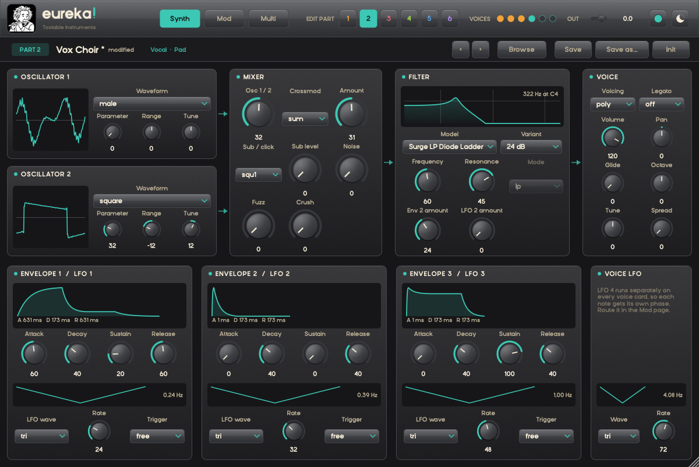
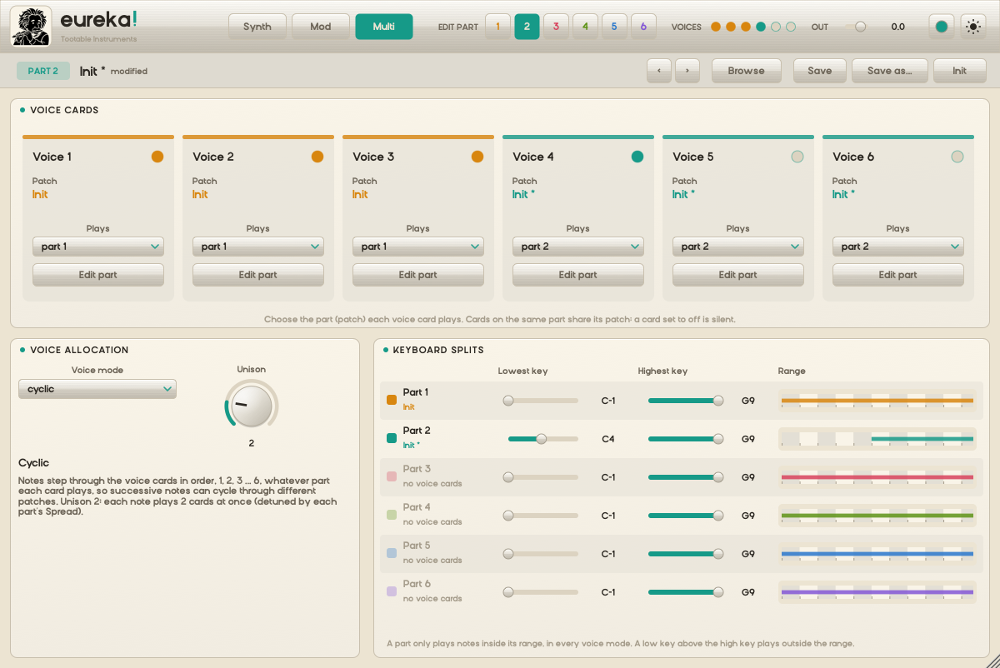

<p align="center">
  
</p>

<h1 align="center">eureka!</h1>

<p align="center"><b>A six-part hybrid polysynth plug-in by Tootable Instruments, built on the
Mutable Instruments Ambika.</b></p>

<p align="center">
  
</p>

## Demo

<p align="center">
  <a href="https://youtu.be/OeMAyKnqreM">
    
  </a>
  <br>▶ <a href="https://youtu.be/OeMAyKnqreM"><b>Watch a short demo of eureka! on YouTube</b></a>
</p>

eureka! runs the original Ambika voicecard firmware natively on your
computer. It adds a model of the analog filter and VCA, a choice of Surge XT
filters, stereo panning and a modern interface. It comes as VST3, AU and a
standalone app for macOS, and as VST3 and a standalone app for Windows.

- 6 parts, each with its own patch, and 6 voices you can share between them
- The Ambika's oscillators and wavetables, plus 7 oscillators from the YAM
  firmware mod, plus 3 envelopes, 4 LFOs and a
  14-slot modulation matrix
- Ambika SVF filter model, 8 Surge XT filters and a model of the Mutable
  Instruments Ripples analog filter
- The Ambika's arpeggiator, two step sequences and note pattern, in sync with
  your DAW
- Keyboard splits, cyclic and poly voice allocation, and unison up to 6 voices
- Separate outputs: any voice can have its own stereo output in your DAW
- Preset browser with tags, the 128 Ambika factory programs built in, and
  import of Ambika `.PAT` / `.PRO` / `.MUL` / `.SEQ` / `.syx` files
- Light and dark themes with your own highlight colour, plus image skins

<p align="center">
  
  <br><i>The Multi page in light mode: six voices shared between parts, with keyboard splits.</i>
</p>

---

## What's new

- **Seq page**: the Ambika's arpeggiator, two step sequences (also
  modulation sources) and note pattern, in sync with your DAW. See
  [Seq page](#seq-page-arpeggiator-and-sequencer).
- **Ripples filter**: a model of the Mutable Instruments Ripples analog
  filter, with LP4, LP2 and BP2 outputs.
- **Separate outputs**: send any voice to its own stereo output in your DAW
  (Multi page, **Output** on each voice card).
- **Window size**: resizing works in every host (including on Windows), the
  size is remembered, and right-clicking the background offers fixed sizes.
  See [Window size](#window-size).
- Ambika programs and multis now import their sequences, and `.SEQ` files
  load into a part.

## Installing

### macOS

1. Download `eureka-macOS.zip` from
   [Releases](https://github.com/Milkman8008/eureka-vst/releases) and unzip it.
2. Copy `eureka!.vst3` to `/Library/Audio/Plug-Ins/VST3/` (or the
   `eureka!.component` to `/Library/Audio/Plug-Ins/Components/` for AU).
3. Downloaded builds are not notarized. If macOS blocks the plug-in, run this
   once in Terminal:
   ```sh
   xattr -dr com.apple.quarantine "/Library/Audio/Plug-Ins/VST3/eureka!.vst3"
   ```
4. Rescan your plug-ins. In Ableton Live, hold **Option** and click
   **Rescan** in Preferences → Plug-Ins. eureka! appears under
   **Tootable Instruments**.

### Windows (64-bit)

1. Download `eureka-windows.zip` from
   [Releases](https://github.com/Milkman8008/eureka-vst/releases) and unzip it.
2. Copy the `eureka!.vst3` folder to `C:\Program Files\Common Files\VST3\`.
3. Rescan your plug-ins. In Ableton Live, turn on **Use VST3 Plug-In System
   Folders** in Options → Preferences → Plug-Ins, then click **Rescan**.
4. For the standalone app, run `eureka!.exe` from any folder and pick your
   audio and MIDI devices in **Options → Audio/MIDI Settings**.

The Windows build is not code-signed: if SmartScreen says "Windows protected
your PC", click **More info**, then **Run anyway**.

To build it yourself, see [Building](#building).

---

## Quick start

1. Load eureka! on a MIDI track and play: you hear part 1's **Init** sound,
   with all six voices playing it polyphonically.
2. Click **Browse** and double-click a factory program to load it.
3. Shape the sound on the **Synth** page, then save it with **Save as...**.

## The interface

**Header (top row)**
- **Synth / Mod / Seq / Multi**: the four pages.
- **Edit part 1-6**: chooses which part the Synth, Mod and Seq pages edit.
  Each part has its own colour.
- **Voices**: one light per voice, in the colour of the part that is playing
  on it.
- **Out**: master output level.
- **Colour swatch**: type a hex code (for example `#E0457B`) to change the
  highlight colour for the edited part, or tick **All parts** to change every
  part. **Reset** restores the theme colours.
- **Sun / moon**: switches between light and dark mode.

**Preset bar (under the header)**: shows the edited part's preset. A `*`
means it has changed since it was loaded or saved.

### Synth page: the sound of the edited part

- **Oscillator 1 & 2**: waveform (classic shapes, wavetables, formant,
  noise...), parameter, range and tune. At the end of the list are seven
  oscillators from the **YAM** firmware mod:
  - `yam_square`: a clean square whose PWM keeps its level
  - `yam_saw`: a clean saw; Parameter mixes in a second saw edge, for a
    sub/super-oscillator sound
  - `yam_triangle`: Parameter folds the triangle
  - `yam_qpwm`: four detuned pulse waves; Parameter sets the detune and the
    pulse width together
  - `yam_fmfb`: FM with feedback; above 64, Parameter adds grit and then
    digital distortion
  - `yam_csaw`: a CS-80 style saw; Parameter adds a notch before the ramp
  - `yam_vowel2`: the vowel oscillator without its phase noise
- **Mixer**: oscillator balance, cross-modulation (sum, sync, ring mod, xor,
  fold, bits), sub-oscillator, noise, fuzz and bit crush.
- **Filter**: choose the **Model**:
  - **Ambika SVF**: low-pass, band-pass or high-pass.
  - **Surge filters**, chosen with **Model**:
    - MULTI Xpander
    - LP Diode Ladder
    - LP Legacy Ladder
    - LP Vintage Ladder
    - FX Comb+
    - FX Comb-
    - FX Sample and Hold
    - FX Cutoff Warp AP

    **Variant** picks the filter's flavour.
  - **Ripples**: a circuit model of the Mutable Instruments Ripples, a
    4-pole analog filter that self-oscillates at high resonance (about three
    quarters up). **Variant** picks its output: LP4 (24 dB low-pass), LP2
    (12 dB low-pass) or BP2 (band-pass). As on the module, raising the
    resonance thins out the bass.

  Frequency, resonance, the envelope 2 amount and the LFO 2 amount work with
  every model. The display shows the response curve.
- **Voice**: voicing (poly, mono, 2x unison, cyclic), legato, volume, pan,
  glide, octave, tune and unison spread.
- **Envelope 1-3 / LFO 1-3**: three ADSR envelopes and three LFOs; the LFOs
  can sync to the host tempo. Envelope 2 shapes the filter (Env 2 amount)
  and, through the modulation matrix, the volume. Envelopes 1 and 3 are free
  for the matrix.
- **Voice LFO**: LFO 4, which runs separately on each voice.

### Mod page

- **Modulation matrix**: 14 slots, each with a source, a destination and an
  amount. Any source can drive almost anything, including **pan** for
  auto-pan or a random stereo spread. Slot 14 is scaled by the mod wheel.
- **Modifiers**: combine two sources into new sources, mod. 1 to mod. 4.
  The operators are add, multiply, attenuate, max, min, xor, quantize and
  lag.

### Seq page: arpeggiator and sequencer

Each part has its own arpeggiator, two step sequences and a note pattern, as
on the Ambika.

- **Keys play**: what holding keys does.
  - **keys**: notes play normally (the default).
  - **arpeggio**: held keys play one at a time. **Direction** (up, down,
    up&down, as played, random, or chord to repeat all held keys),
    **Octaves** (1-4) and **Rhythm** (which of 16 steps play) shape it.
  - **pattern**: hold a key and the **Note pattern** plays, transposed so
    that `key` is the note you hold.
- **Step**: the length of one step, from 1/1 to 1/96 (1/16 by default).
- **Sequence 1 and 2**: 16 values each; drag across the bars to draw them.
  They always run, whatever Keys play is set to, and are modulation sources
  in the Mod page (**seq. 1**, **seq. 2**): route them to the cutoff, the
  oscillator mix, pan... **arp** is the arpeggiator rhythm as a source.
- **Note pattern**: for each step a **Gate** (click to play or rest), a
  **Note** (drag up and down, or use the mouse wheel; double-click resets it
  to the key), a **Velocity**, and a **Tie** that glides into the next step.
- **Length**: each sequence and the pattern can be 1-16 steps long, so they
  can run against each other.

When your DAW plays, the steps follow its tempo and position, and restart in
place when you loop or jump. When it is stopped (or in the standalone app),
they run at the tempo and start with the first key you press.

### Multi page: playing several parts at once

- **Voices 1-6**: each voice chooses which part it plays, or **off**.
  **Edit part** jumps to that part's sound.
- **Output** (each voice): **main** (the default) or **own output**. A voice
  on its own output leaves the main mix and plays on output "Voice 1"..
  "Voice 6" of the plug-in, so you can process it on its own channel. Enable
  those outputs in your DAW first (in Logic, insert the multi-output version
  of eureka!; in Ableton Live, choose eureka! as the input of an audio track;
  in Reaper, add outputs in the plug-in's routing). Until the DAW enables a
  voice's output, the voice stays on main and its card says so. The
  standalone app has the main output only.
- **Voice allocation**: decides how notes reach the voices:
  - **Poly** (default): each note takes the free voice that has rested
    longest.
  - **Cyclic**: notes step through voices 1 → 6 in order. Give the voices
    different parts and every note plays the next patch.
  - **Per part**: works like the original hardware. Each part plays every
    note on its own voices, using its own Voicing setting, and parts layer.
  - **Unison** (Poly and Cyclic): plays 1-6 voices per note, detuned by each
    part's Spread.
- **Keyboard splits**: a lowest and highest key for each part. Use them to
  put a bass on the left hand and a lead on the right, or set overlapping
  ranges for layers.

eureka! listens on every MIDI channel. The sustain pedal works in all modes.

**Example layouts**
- *Big poly*: all six voices on part 1, voice mode Poly.
- *Round robin*: voices 1-3 on part 1 and voices 4-6 on part 2, voice mode
  Cyclic. Notes alternate between the two sounds.
- *Split*: voices 1-2 on part 1 with keys up to B2, voices 3-6 on part 2
  from C3 up.
- *Thick lead*: voice mode Poly with Unison 3, which gives two notes of three
  voices each.

## Presets

A preset stores the sound of one part. The voice setup on the Multi page is
saved with your DAW project instead.

- **< / >**: previous or next preset.
- **Save**: overwrites the current preset.
- **Save as...**: saves a new preset with a name, tags, author and comment.
- **Init**: resets the edited part, or **Everything** (all six parts plus
  the voice setup).
- **Browse**: search, filter by tag, double-click to load, rename, delete,
  or show the presets folder.

Your presets are saved in **Documents/eureka/presets** as `.eurekapreset`
files. You can copy them to share them, and sub-folders are included.

A preset includes the part's Seq page: arpeggiator settings, sequences and
note pattern.

**Ambika sounds**: the 128 Ambika factory programs are built in. In the
browser they are tagged **Factory** and are read only: load one and use
**Save as...** to keep your own version. **Import Ambika files...** opens
original Ambika SD-card files (`.PAT`, `.PRO`, `.MUL`, `.SEQ`) and SysEx
dumps (`.syx`). It can load a file straight into the edited part (a `.MUL`
multi sets up all six parts; a `.SEQ` sets only the part's arpeggiator and
sequences), or add whole folders to your library under `presets/Imported`.
Programs bring their arpeggiator settings and sequences with them.

## Window size

Drag the bottom-right corner to resize the window (60% to 200%), or
right-click an empty part of the window background for a list of sizes. The
size is saved with your project, and new windows open at the size you used
last. If your DAW gives the window a different shape, eureka! keeps its
proportions and centres itself.

## Custom looks (skins)

You can change the background, logo and knobs with images you edit in
Photoshop or any image editor. A template pack with guide images is in
[`plugin/skin-template`](plugin/skin-template) (see its README.txt). Put
your files in **Documents/eureka/skin** and reopen the plug-in window.

## Not included (yet)

- Ragas and microtuning
- The Ambika's 4-pole filter cards (the Ambika SVF, Surge and Ripples
  filters are available instead)

---

## Building

**macOS:** you need the Xcode command line tools and CMake 3.22 or newer.

```sh
git clone --recursive https://github.com/Milkman8008/eureka-vst.git
cd eureka-vst
cmake -S plugin -B plugin/build/release -DCMAKE_BUILD_TYPE=Release
cmake --build plugin/build/release -j8
```

**Windows:** you need Visual Studio 2022 with the **C++ Clang tools for
Windows** component, plus CMake. Run in a Developer Command Prompt:

```bat
git clone --recursive https://github.com/Milkman8008/eureka-vst.git
cd eureka-vst
cmake -S plugin -B build -A x64 -T ClangCL
cmake --build build --config Release
```

Every push to GitHub also builds the Windows version automatically (the
**Actions** tab); see [`.github/workflows/build.yml`](.github/workflows/build.yml).

The built plug-ins end up in
`plugin/build/release/AmbikaPlugin_artefacts/Release/`, under `VST3/`, `AU/`
and `Standalone/`. Developer notes (how the firmware is ported, the filters,
tests and preset format) are in [plugin/README.md](plugin/README.md).

## Credits and licence

eureka! is built on the **Ambika** by **Mutable Instruments**: the firmware
and design are by Emilie Gillet. The original Ambika README is in
[AMBIKA-README.md](AMBIKA-README.md), and the hardware and firmware sources
are kept in this repository unchanged. The extra filters come from
**Surge XT** (sst-filters, by the Surge Synth Team). The Ripples filter is
Tyler Coy's circuit model of the Mutable Instruments Ripples, from VCV
Rack's Audible Instruments. The `yam_`
oscillators come from the **YAM** Ambika firmware by bjoeri. The plug-in is built
with **JUCE**.

eureka! is released under the **GPL-3.0**, like the Ambika firmware, the
Surge filters and the Ripples model.
